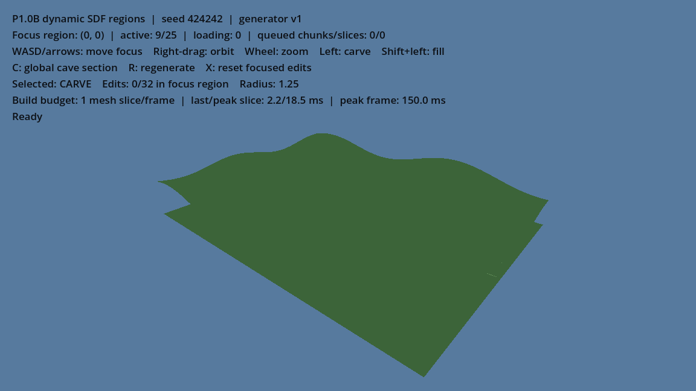
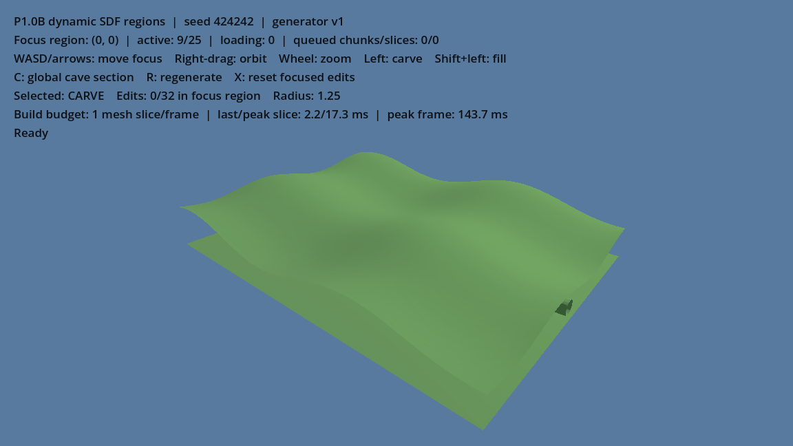
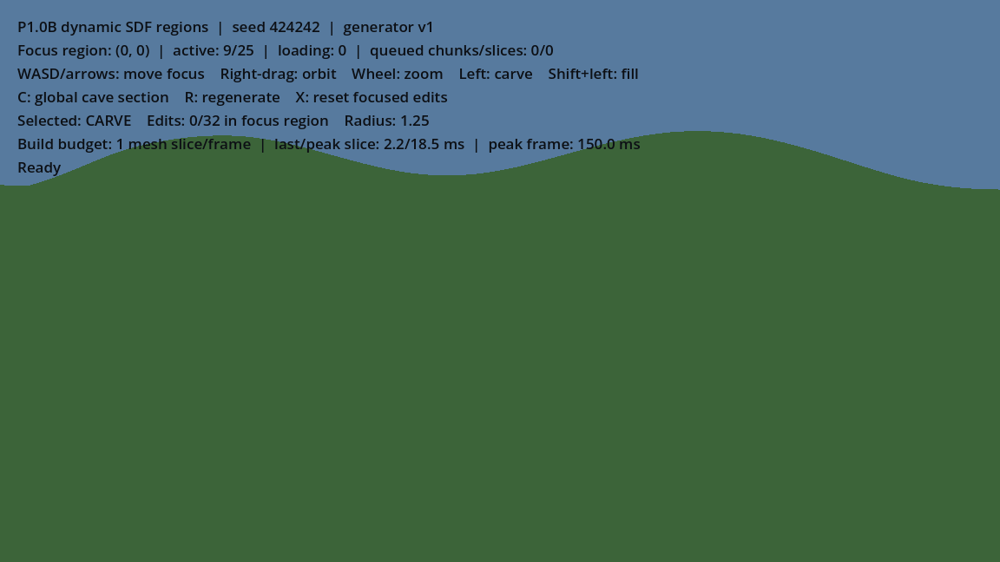
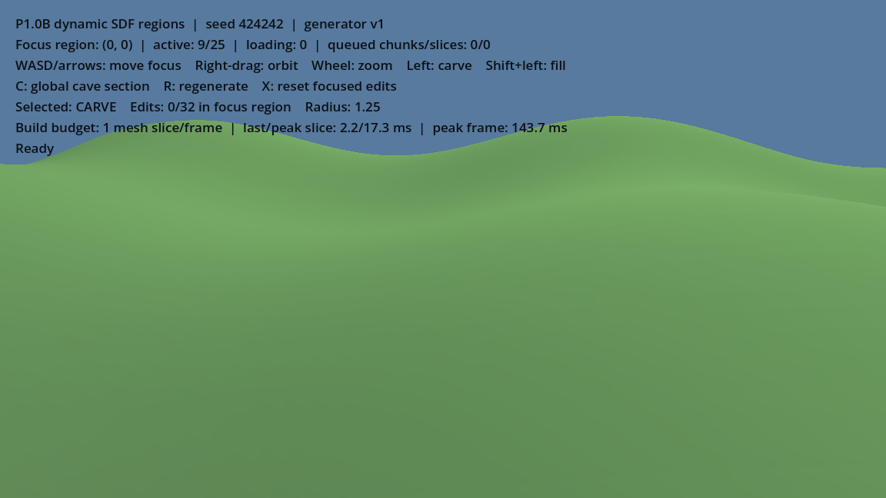
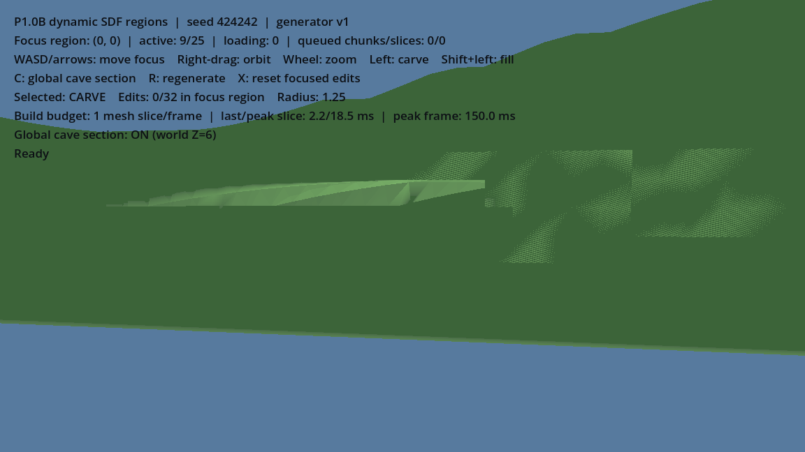
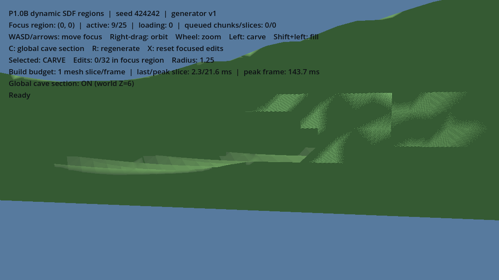

# P1.0B lighting follow-up — Issue #89

This focused correction follows the owner GUI report that the merged P1.0B terrain still looked flat. It changes only the lighting configuration and lighting-focused tests/evidence; streaming, SDF generation, chunking, controls, persistence and networking are unchanged.

## Before and after

The captures use Godot 4.7.2 Compatibility on the same local renderer, seed `424242`, 1152×648 viewport, initial target and identical exterior/cave orbit offsets. The `before` capture overrides only the lights at runtime to the prior scene values (ambient 1.5, directional 1.3, camera light 0.42 and key rotation X -48°). The `after` capture uses the candidate scene values (ambient 1.2, directional 1.3, camera light 16 and key rotation X +48°). The terrain material and generated world are identical.

| View | Before | After |
| --- | --- | --- |
| Wide exterior |  |  |
| Close exterior |  |  |
| Global cave section |  |  |

The close exterior capture's measured terrain luminance changed from mean 88.0/std-dev 0.0 to mean 133.84/std-dev 7.70 (8-bit luma). At the cave view, it changed from mean 91.15/std-dev 10.22 to 82.82/std-dev 14.09: average cave luminance is lower, while visible luminance variation is higher. The shaded cavity remains darker than the old flat rendering, so owner GUI confirmation of readability is still required. These measurements do not replace visual acceptance. The capture report records camera pose, configuration and per-view statistics in `lighting_capture.json` next to each image set.

## Chosen lighting and shadow tradeoff

- Environment uses colored ambient light, energy `1.2`, with sky contribution `0.0`.
- The shaded green material is unchanged.
- The directional key remains energy `1.3`, now rotated to `(48, -28, 0)` degrees to light the terrain's surface slopes in Compatibility rendering. Ambient remains slightly below the key.
- The camera child spotlight remains forward-aligned, range `72`, angle `58°`, attenuation `1.0`, no shadows; energy is `16`. It has no measurable effect at the far wide view and changes a localized portion of the close cave view (10,306 of about 434,310 terrain-classified pixels changed by more than 1%; maximum absolute RGB delta 0.188, mean RGB delta 0.00315). This keeps it a close inspection fill rather than broad frontal wash.
- Directional shadows were tested on/off. In the close exterior view, shadows changed 537,221 of 537,311 classified terrain pixels and lowered mean luma from 133.84 to 112.69; the cave view showed compatibility-renderer striping/acne. With VSync disabled and 180 post-warmup frame intervals on this GTX 1050 Ti setup, close-exterior mean interval was 1.047 ms without shadows and 1.489 ms with shadows; cave was 0.922 ms and 1.226 ms. Keep both lights' shadows disabled. These are machine- and scene-specific CPU-side frame-interval samples, not GPU or general performance guarantees.

## Reproducing captures

From the repository root in PowerShell:

```powershell
$godot = 'C:\Tools\Godot\Godot_v4.7.2-stable_win64_console.exe'
& $godot --path .\game --script res://tests/terrain_lighting_capture.gd -- (Join-Path $PWD 'docs/evidence/p1-0b-lighting/before') '1.5' '1.3' '0.42' 'old_key'
& $godot --path .\game --script res://tests/terrain_lighting_capture.gd -- (Join-Path $PWD 'docs/evidence/p1-0b-lighting/after')
```

The script waits for the same nine-region seed, records initial wide/close exterior and global cave-section positions, compares camera fill and directional shadows, and writes PNGs plus JSON metrics. It is a local visual evidence helper, not part of runtime or headless validation.

## Owner GUI retest

Open `game/project.godot` in Godot 4.7.2 and run `scenes/terrain_demo.tscn` (F6). Wait until the status reads `Ready`. Inspect the initial exterior, orbit with right mouse drag, zoom with the wheel, and press `C` to show the global cave section. Orbit close to the cave wall and compare surface facets, slopes and the cavity interior. Confirm the green material remains readable and the camera fill does not look like a flat white/front light. `R` should still regenerate the same seeded terrain. Source tests and automated captures pass, but owner GUI confirmation remains pending.

## Scope and retained holds

The focused review must confirm no changes to dynamic-region streaming, the seed/generator/SDF, chunks/seams, input bindings, edits, persistence or networking. The P1.0B streaming limitations recorded in its implementation checkpoint remain. This work does not authorize protected-host operations or alter any F2-G1 hold: `CURRENT_PROTECTED_STATE_UNKNOWN`, `V3_NOT_ATTESTED`, `ACL_REVIEW_REQUIRED`, `G1_BLOCKED_ENVIRONMENT`, `F2_G1_RELEASE_HOLD`.
