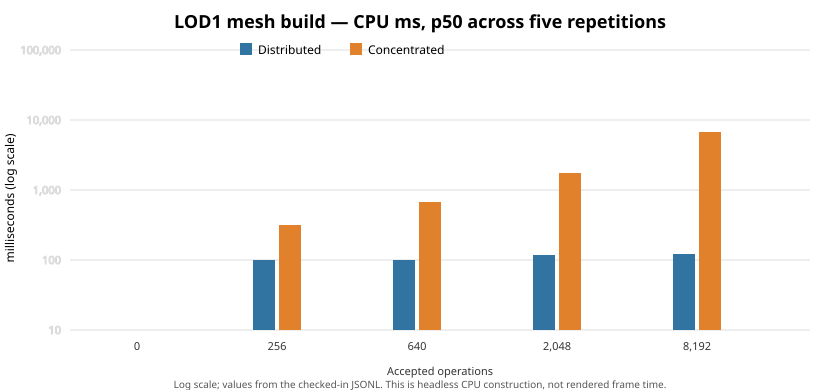
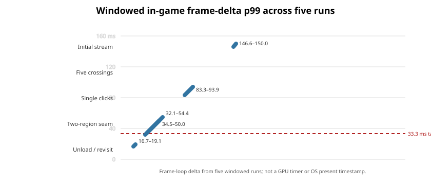

# P3.1 Integration Gate — Issue #131

Date: 2026-10-26

Disposition: **`P3_1_INTEGRATION_GATE_PERFORMANCE_BLOCKED_WITH_EVIDENCE`**
Evidence only; no production change or merge.

## Identity and scope

- Repository origin: `https://github.com/publiomcko-cloud/procedural-sandbox-simulation.git`
- Tested production baseline: `92b442d7f5b605c7bc9c48fac2aceea9d71813aa` (PR #129 head).
- PR #129 was rechecked as open, draft, unmerged, with that exact head. `origin/main` was `5997a76d345f45bf86edfe83f690336391e8be27`.
- Benchmark branch: `bench/p3-1-issue131-integration-gate`; isolated worktree: `C:\Dev\sandbox-sim-p3-1-issue131-benchmark`.
- No production file changed. The new benchmark is opt-in and test-only; the only other source change instruments the existing end-to-end test to report the in-game frame delta ring.
- Godot: `4.7.2.stable.official.ed1daf0bf`, executable `C:\Tools\Godot\Godot_v4.7.2-stable_win64_console.exe`, SHA-256 `c8f0a6bc45a19b33541501e57f6f7cd972ab18453743266339d495cbbe846643`.
- Hardware: Windows 11 Pro 10.0.22631; MACHINIST X99 PR9; Intel Xeon E5-2690 v4, 14 cores / 28 logical processors; 64 GiB RAM; NVIDIA GeForce GTX 1050 Ti, 4 GiB, driver 581.57; OpenGL 3.3.0, Godot GL Compatibility; window 1152×648.
- Production and test-file SHA-256 values, exact manifests, command inputs and raw logs are indexed under [`results/`](results/).

## Execution and reproducibility

The final integrated headless campaign used a fresh profile and unique output root, started 2026-10-26 08:37:33 local time and ended 08:44:00. The process completed in 385.001 seconds with exit code 0 and emitted `P31_INTEGRATION_BENCH_PASS: edit_runs=50 population_targets=20 failures=0`. It performed five repetitions for each of ten edit histories, five repetitions for each of four cumulative population targets, and one transactional entity scenario. The manifest digest is `2dff9ccd5b98e1ea722051b25f961ff8f64c3ae698f3bc12102826e04ec3088d`.

The launcher was Godot console PID 3368; while running, Windows process inspection observed its Godot engine child PID 35424, parent PID 3368, with the same `--headless --path ... --script res://tests/p3_1_integration_gate_benchmark.gd` command. The immutable raw stdout/stderr, exit code, PIDs, result manifest and SHA-256 inputs are retained. The Godot process was headless, so its frame intervals are not presented-FPS measurements.

The runner's optional `P31_SOURCE_SHA` environment variable was empty in this final invocation, so embedded `source_sha` result fields are empty. The raw files were not edited after the run. Exact attribution is instead established by the retained process command and time, exact worktree HEAD (`92b442…`), clean production diff, and SHA-256 of both test source files recorded in `results/run-attribution.json`. This is a harness reporting limitation, not concealed as a populated embedded source field.

Scenario inputs are versioned and seeded (`131102026`), CARVE/FILL alternating, radius 580 mm, with signed distributed region coordinates and concentrated histories. The five counts were 0, 256, 640, 2,048 and 8,192. Each edit row compares the indexed evaluator with full ordered replay at seven fixed probes, writes the initial world, restarts, samples cold and warm queries, performs unchanged repeated saves, appends one delta operation and verifies the additional save, then builds LOD0 and LOD1 from the saved state. Both LOD builders were valid in all 50 rows. The 50 rows report zero full-replay mismatches. Population tests loaded production first-party and example declarative packages, walked signed regions and recorded actual publication, active/resident counts and timings. The entity scenario ran 98 commands over 16 explicit entities, then restarted and checked reconstruction.

## Headless edit and persistence results

Each entry below is median / worst-of-five (`p50 / p95` across the five runs) in milliseconds unless stated otherwise. `cold/warm query` is the seven-probe sampling batch; LOD numbers are CPU mesh construction, not GPU upload or display time. The full per-run JSONL/CSV is authoritative.

| Layout | Ops | Save p50/p95 | Restart p50/p95 | SDF cold p50/p95 | SDF warm p50/p95 | LOD0 p50/p95 | LOD1 p50/p95 | Disk bytes | Static-memory Δ | Max query candidates | Segments |
|---|---:|---:|---:|---:|---:|---:|---:|---:|---:|---:|---:|
| Concentrated | 0 | 15.1 / 15.5 | 1.7 / 1.8 | 0.014 / 0.015 | 0.013 / 0.013 | 19.1 / 19.7 | 98.9 / 103.8 | 3,561 | 0.11 MiB | 0 | 0 |
| Concentrated | 256 | 56.7 / 76.7 | 24.1 / 25.0 | 0.704 / 0.714 | 0.693 / 0.697 | 73.3 / 74.4 | 319.4 / 321.1 | 54,964 | 1.13 MiB | 256 | 2 |
| Concentrated | 640 | 126.3 / 139.9 | 58.4 / 59.5 | 1.791 / 1.794 | 1.738 / 1.766 | 158.5 / 161.6 | 659.6 / 678.2 | 134,781 | 2.63 MiB | 640 | 5 |
| Concentrated | 2,048 | 372.7 / 450.1 | 186.9 / 202.0 | 7.485 / 8.626 | 6.367 / 7.491 | 488.9 / 733.1 | 1,763.1 / 2,094.5 | 446,394 | 8.11 MiB | 2,048 | 16 |
| Concentrated | 8,192 | 1,513.3 / 1,529.7 | 776.3 / 810.5 | 39.119 / 41.675 | 37.227 / 43.044 | 1,908.7 / 2,181.4 | 6,885.1 / 7,224.1 | 1,834,453 | 32.54 MiB | 8,192 | 64 |
| Distributed | 0 | 15.6 / 23.5 | 1.8 / 2.4 | 0.014 / 0.027 | 0.013 / 0.027 | 20.5 / 36.8 | 95.5 / 113.5 | 3,561 | 0.11 MiB | 0 | 0 |
| Distributed | 256 | 77.5 / 86.3 | 27.3 / 38.2 | 0.106 / 0.107 | 0.090 / 0.130 | 19.1 / 20.6 | 100.1 / 104.8 | 60,722 | 1.41 MiB | 5 | 2 |
| Distributed | 640 | 135.1 / 137.0 | 61.1 / 84.6 | 0.188 / 0.189 | 0.172 / 0.179 | 19.2 / 20.3 | 100.8 / 103.6 | 141,081 | 3.20 MiB | 9 | 5 |
| Distributed | 2,048 | 368.7 / 385.3 | 204.4 / 215.3 | 0.731 / 1.085 | 0.508 / 1.047 | 20.1 / 22.3 | 116.6 / 123.4 | 449,189 | 9.47 MiB | 27 | 16 |
| Distributed | 8,192 | 1,418.6 / 1,498.2 | 811.0 / 904.9 | 5.075 / 6.745 | 2.367 / 2.568 | 24.8 / 27.3 | 122.0 / 125.6 | 1,790,436 | 37.02 MiB | 106 | 64 |

Unchanged repeated saves wrote no new segment files, but still validate/read retained immutable material. At 8,192 edits, the append-delta case reused all 64 existing segments and wrote one new segment; its cold validation read 64 segments (0.89 MiB distributed, 1.12 MiB concentrated), while warm queries reported zero segment reads and cache hits. The measured static-memory delta is Godot's static allocator counter, not process RSS. Five windowed process monitors sampled 285 rows and observed a maximum 216,924,160-byte working set (206.88 MiB). A separate sampled headless edit/population run observed a 254,353,408-byte peak working set over 394 engine samples; it completed its edit/population rows but exited 1 later in entity setup. Do not treat that RSS sample as the final entity run's memory measurement. The original windowed monitor CSV used the host locale's decimal comma without quoting the final field; the normalized, valid [`windowed-process-samples.csv`](results/windowed-process-samples.csv) combines it losslessly for numeric analysis, while the original captures remain alongside it.



The concentrated 8,192-operation query still considers all 8,192 operations. The conservative spatial index helps distributed workloads (106 maximum candidates), but dense local histories remain linear at the hot region. At 8,192, the concentrated LOD1 CPU mesh build is about 6.9 seconds, while distributed is about 122 ms. These are CPU timings and do not imply equivalent rendering frame time.

## Population and entity results

Population publication and mesh build values are the median and worst reported per-run `p50/p95` across five repetitions. Generation targets are first-publication thresholds, so region-batched publication overshoots some nominal counts; this remains visible rather than rounded away.

| Requested milestone | Actual cumulative objects | Peak resident instances | Peak active regions | Regions published | Publication p50 / p95 (ms) | Region mesh p50 / p95 (ms) |
|---:|---:|---:|---:|---:|---:|---:|
| 100 | 103 | 103 | 23 | 23 | 38.3 / 60.1 | 32.3 / 55.2 |
| 500 | 500 | 120 | 25 | 129 | 35.4 / 56.5 | 31.3 / 49.3 |
| 1,000 | 1,001 | 122 | 25 | 256 | 35.8 / 57.0 | 31.5 / 51.6 |
| 2,000 | 2,002 | 122 | 25 | 514 | 36.0 / 55.5 | 31.8 / 48.4 |

The active-region cap remained 25 and publication budget was one region per process tick; maximum resident object instances were 122. This is region-batched procedural population work, not proof that 2,000 unique visuals are simultaneously resident.

The entity sequence passed with 98 durable commands, world revision 98, 98 receipts, history depth/cursor 34/34, 16 placed identities and 18 reconstructed IDs after restart (including procedural identities). Restart load was 200.362 ms and the entity store was 353,628 bytes. Action latency p50/p95/p99 in the raw record: PLACE 214.9/443.7/443.7 ms; SET_COMPONENT 234.0/445.7/445.7 ms; DELETE 222.8/418.9/418.9 ms; UNDO 231.0/425.7/433.1 ms; REDO 227.5/483.2/483.2 ms; procedural RESTORE 512.8 ms (one sample). This scenario validates command/restart behavior at 16 entities, not command scaling to 2,000 entities.

## Windowed interactive performance (not headless)

Five fresh Godot process runs used the actual Windows display server, 1152×648 window and GTX 1050 Ti. The engine's in-game frame-delta sampler, not an OS presentation timestamp or GPU timer, supplies frame distributions. Thus these rows are windowed-render-loop measurements; they are not a claim of GPU completion or exact presented FPS. R1–R5 were separate processes, but OS file cache was not flushed; only R1 is cold-observed at the process level, and runs 2–5 may benefit from warm OS caches.

| Run | Cold process start (ms) | Five region crossings p50/p95 (ms) | Crossing frame p95/p99 (ms) | Single click p50/p95 (ms) | Seam click p50/p95 (ms) | 256-op accepted→visible (ms) | Revisit frame p99/max (ms) | Revisit stalls >33/>50/>100 ms |
|---:|---:|---:|---:|---:|---:|---:|---:|---:|
| 1 | 1,802 | 551 / 568 | 35.3 / 132.5 | 80.9 / 81.6 | 80.2 / 96.2 | 140.0 | 92.2 / 92.6 | 12 / 10 / 0 |
| 2 | 1,799 | 584 / 760 | 41.0 / 127.1 | 81.4 / 84.0 | 80.4 / 96.3 | 119.6 | 87.6 / 87.6 | 8 / 5 / 0 |
| 3 | 1,773 | 553 / 567 | 31.1 / 133.3 | 71.9 / 81.2 | 80.1 / 96.1 | 120.0 | 93.9 / 93.9 | 14 / 9 / 0 |
| 4 | 1,787 | 552 / 566 | 35.2 / 116.7 | 80.8 / 83.1 | 79.9 / 112.9 | 129.3 | 96.4 / 96.4 | 16 / 9 / 0 |
| 5 | 1,805 | 551 / 567 | 33.1 / 131.1 | 80.9 / 81.9 | 80.2 / 96.3 | 137.2 | 123.4 / 123.4 | 11 / 9 / 1 |

The initial streamed scene had 83–85 sampled frames per run and p99 146.6–150.0 ms, with three stalls over 100 ms in each run. Exact per-phase frame samples and all five console/process logs are retained. The 256-operation final ledger edit had 119.6–140.0 ms accepted-to-visible latency. The target p99 of 33.3 ms and “no perceptible stall” objective are not met by these measurements.



## Integrity, limits and validation

- Final integrated headless harness: exit 0; 50/50 edit rows PASS, 20/20 population rows PASS, one entity scenario PASS, zero failures, zero full-replay mismatches. Each edit layout/count had five runs. Each population target had five runs.
- The P3.1 storage suite exercised by the full validator reported `TERRAIN_WORLD_V2_STORAGE_PASS: assertions=3516 failures=0`, including persistence/recovery/corruption contract regressions. The benchmark itself used disposable roots and did not modify user saves.
- Complete `scripts/validate.ps1`: Godot 4.7.2, isolated APPDATA/LOCALAPPDATA/TEMP profile, exit 0, `VALIDATION_PASS: L0-L2; GUI visual test remains an owner task`. Twenty-one explicit PASS assertion groups sum to 21,464 assertions, zero failures. There were three nonfatal existing camera target/up colinearity warnings in the entity GUI harness; they did not affect the result.
- Five windowed end-to-end runs each passed 251 assertions. Full validation ran headless; it does not repeat or replace the five windowed runs.
- No presented-frame timestamp, GPU timer, VRAM peak or hardware-counter data was available. Windowed render-loop deltas are not a GPU/present measurement. Headless validation/performance frame intervals are not presented FPS.
- Issue #133 remains `NOT_REPRODUCED / CAUSE_UNKNOWN`; no speculative code correction was made.
- All five F2-G1 holds remain unchanged. PR #129 remains draft/unmerged. No Voxel Tools/native code, issue #108, merge, or user-save operation occurred.

## Architectural alternatives

**A — Persistent derived chunk-mesh cache.** It may reduce rebuild time on revisits, especially for stable LOD1 chunks. A cache key must include world seed/generator version, exact ordered-ledger revision/prefix, LOD/mesher/material/cut state, chunk identity and every neighboring sampling/normal dependency. It duplicates large derived buffers on disk, can multiply stale entries, and requires correct invalidation across face/edge/corner region dependencies. It cannot become authoritative or hide a failed canonical replay. It will not fix the 8,192 concentrated evaluator's linear candidate set unless sampling itself is separately optimized.

**B — Per-chunk volumetric snapshot.** It could amortize repeated evaluation, but a sampled grid is not automatically the same continuous SDF produced by the ordered min/max CARVE/FILL operators. Interpolation or quantization can change geometry, normals, picker intersections and LOD seams. Exact snapshots require a precisely defined sample lattice, residual ordered replay, prefix identity, dependency halos, robust invalidation, quota/recovery rules, and proof at all admitted probes. Storage and memory grow with resolution × chunks × revisions; lossy compaction is out of scope. The full replay parity and boundary tests must remain the oracle.

**Recommendation:** optimize measured costs before adding either cache family. First target dense local candidate evaluation and LOD1 CPU meshing, preserving operation chronology and exact surface results. Then measure incremental save verification and streaming queue/main-thread publication. Prototype mesh cache only after deriving a complete dependency key and bounded eviction strategy. Consider volumetric snapshots only as an isolated, exactness-tested experiment after specifying lattice/error semantics; do not adopt for canonical state based on these results.

## Reproduction

From a fresh checkout at PR #129 SHA, initialize/import the editor once, then run the harness in an empty disposable absolute directory:

```powershell
$env:P31_BENCH_OUTPUT_DIR = 'C:\path\to\new-empty-temp\output'
$env:P31_BENCH_PHASE = 'all'
$env:P31_SOURCE_SHA = '92b442d7f5b605c7bc9c48fac2aceea9d71813aa'
& 'C:\Tools\Godot\Godot_v4.7.2-stable_win64_console.exe' --headless --path .\game --script res://tests/p3_1_integration_gate_benchmark.gd
```

For the separate windowed run, use the test launcher documented by the existing terrain E2E test (no `--headless`) and preserve a fresh profile and one log/process CSV per run. Do not infer a frame-present result from the headless command. Full canonical validation command: `powershell -ExecutionPolicy Bypass -File .\scripts\validate.ps1` with `GODOT_BIN` pinned to the executable above.

## Prioritized bottlenecks and disposition

1. **Dense-region SDF candidate count and resulting meshing:** 8,192 concentrated operations produce 8,192 candidates, ~39 ms cold seven-probe batch and ~6.9 s LOD1 build. This is the dominant demonstrated scalability issue.
2. **Edit-to-visible and streaming stalls:** normal single clicks ~72–82 ms p50; concentrated history reaches ~120–140 ms at the final 256-command ledger; crossing p95 ~0.57–0.76 s; windowed frame p99 often 116–133 ms. Queueing/worker limits are respected but do not prevent tail stalls.
3. **Persistent command latency:** entity command action p95 is ~419–513 ms in this small 16-entity test; investigate storage transaction overhead before increasing entity load.
4. **Save/restart scale:** 8,192-operation saves ~1.4–1.5 s and restarts ~0.78–0.81 s; unchanged save and append paths still revalidate immutable bytes. Storage is ~1.8 MiB at this scale, while static memory delta is ~33–37 MiB.

The implementation shows deterministic replay, persistence and identity checks through these tested sizes, but it does not meet the initial smooth-playability targets. This gate is therefore **performance-blocked with evidence**, not a data-integrity failure and not authorization for issue #108, snapshots, backend changes or release. Independent review and owner acceptance remain separate.
