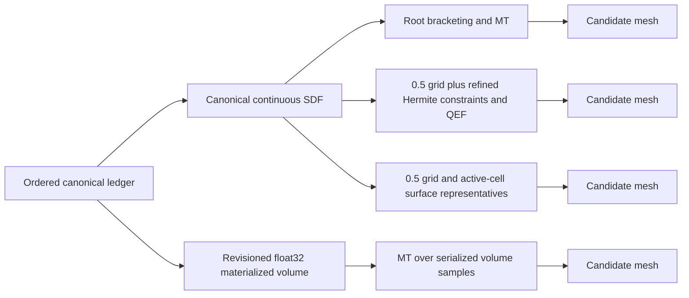

# P3.1 R9 — Four architecture prototype comparison

**Overall disposition: `INCOMPLETE_WITH_EVIDENCE`; no production winner.**

R9 authorizes research only. All four candidates ran on the same Windows host, pinned Godot, frozen manifest and bounded ROI, but every candidate stopped at its first zero-edit mandatory gate. Candidate A hit the node stop-loss before emitting a mesh; B, C and D emitted zero-edit meshes that failed exact topology. Consequently, there is no complete architecture comparison, no geometry-quality acceptance, and no basis for a production decision.

## Provenance and common inputs

- Common R8.2 geometry baseline: `4f08b67522507bd196a74a1089c773f272235343`.
- R9 preregistration plus shared test-helper commit used as the direct parent for candidates: `a60d38df4f96b9007162e8fd917b3d14f29dcb0f`.
- Frozen R9 input JSONL SHA-256: `2b44cb52ef091c2527fa2f8b06859752cc7cfaa14bcafe94d4a4c55b0cdd908f`.
- Godot `4.7.2.stable.official.ed1daf0bf`, executable SHA-256 `c8f0a6bc45a19b33541501e57f6f7cd972ab18453743266339d495cbbe846643`.
- All worktrees used isolated Godot profiles and disposable paths. The protected development workspace was not used for candidate execution. No production source, save schema, native dependency, GUI/PhysicsServer path, Issue #108, or F2-G1 state changed.

Each candidate was a worktree-local untracked script during its first and only scenario run. The report commit then packaged the same bytes. Physical source SHA-256 pins the exact measured source, while the commit is the published review identity:

| Candidate | Published HEAD | Direct parent | Measured script SHA-256 | Draft PR |
|---|---|---|---|---|
| A | `2306f2dea2f0a780ead1cb4968f4e9c7277bc601` | `799b7bfabb65eabb706046dff06ff5231f599ea2` | `6029890cc090fc10373c885a26f8439ec06f1c012dd6471773105f7bae91499d` | [#170](https://github.com/publiomcko-cloud/procedural-sandbox-simulation/pull/170) |
| B | `2ae1445551a1e1fcaab81f20075786a93135b43d` | `a60d38df4f96b9007162e8fd917b3d14f29dcb0f` | `c156a90f880e7dafeb2662b2c10083fd6616e4c8d190f46276bba8ec7847db65` | [#171](https://github.com/publiomcko-cloud/procedural-sandbox-simulation/pull/171) |
| C | `1949f3c68bc63bfca644e5e6963f89dd114e3e5d` | `a60d38df4f96b9007162e8fd917b3d14f29dcb0f` | `2c8bfaf8954d0941bf63a5832148a55dae0504a06bd1445aca5b72a04945734e` | [#172](https://github.com/publiomcko-cloud/procedural-sandbox-simulation/pull/172) |
| D | `1d8bc2b8015616dd4a9a0a75fd643f807bc6fbb4` | `a60d38df4f96b9007162e8fd917b3d14f29dcb0f` | `49f5575983530111301d55930d650927af1cd5cb32fa72d3e6e49dd25598b6cb` | [#173](https://github.com/publiomcko-cloud/procedural-sandbox-simulation/pull/173) |

The A report branch contains two commits because raw logs were added after the first evidence commit. Every candidate report has a SHA-256 inventory for its source, common helper/input, import/check logs, focused run, and complete regression log. Candidate D's isolated volume bytes are also preserved and hashed.

## Candidate dispositions and measurements

| Candidate | Disposition and first stop | Zero-case observations | Geometry not established |
|---|---|---|---|
| A — root-aware Marching Tetrahedra | `R9_A_BLOCKED_WITH_EVIDENCE`; unique-sample stop-loss | 2,457 initial grid nodes; root bisection crossed the 10,000 unique sample ceiling; script stopped after 525,821 µs | No completed mesh, topology, seam, root/surface fidelity or later scenario |
| B — adaptive Hermite/QEF dual contouring | `R9_B_BLOCKED_WITH_EVIDENCE`; zero topology | 6,241 unique samples; 356 active parent cells; 598 triangles; 214,694 µs; 110 internal open edges; 0 nonmanifold, degenerate or winding failures | No edited/seam/ray cases. Prototype refines Hermite constraints but retains parent-cell topology, not balanced adaptive leaves |
| C — Surface Nets | `R9_C_BLOCKED_WITH_EVIDENCE`; zero topology | 2,457 samples; 356 active cells; 1,424 linear crossing constraints; 598 triangles; 59,946 µs; 110 internal open edges; 0 nonmanifold/degenerate/winding failures | No repeat determinism build or downstream cases; output does not report rejected-triangle count |
| D — revisioned materialized float32 volume + MT | `R9_D_BLOCKED_WITH_EVIDENCE`; zero topology | 2,457 nodes; 9,828-byte density payload / 9,935-byte serialized file; materialize 24,679 µs, extraction 39,027 µs; 1,784 triangles; 1,121 internal opens, 152 ROI-boundary opens, 355 nonmanifold edges | No edit revision, seam, ray, picker or later scenarios; corruption reload rejection was not exercised |

Times are single, headless CPU observations from differently structured steps; they are neither p50/p95 distributions nor an apples-to-apples performance ranking. A's elapsed value is time to stop-loss, not completed construction. B/C/D had no repeated performance runs because a mandatory geometry gate failed. No RSS/peak memory was collected; D's serialized volume size is the only measured storage value. GPU, presented frame times, PhysicsServer, collision, and GUI were `NOT_RUN` for every candidate.

### Architecture sketches

Candidate D separates materialization authority from its chosen extractor conceptually, but this run measured only the combined volume-plus-MT route and failed topology. It therefore does not demonstrate any operational benefit of a volume authority. C's optional relaxation was not reached or implemented in the measured prototype. A did not reach interface templates; B did not reach conforming mixed-resolution extraction.

## Fidelity, topology, connectivity, picking and physics

- A has no mesh output because its bounded construction stopped at 10,000 unique samples.
- B/C fail the exact zero-case internal-open-edge invariant (110 each). D fails with 1,121 internal opens and 355 nonmanifold edges.
- No frozen X+ or X− seam case, negative-region seam, mixed-LOD mesh, triangle 3103, CARVE, or FILL→CARVE candidate geometry gate ran.
- No candidate produced surface displacement, normal-angle distributions, canonical root-count comparison, sampled/extracted cave connectivity, mesh ray hit agreement, or independent collider reference results.
- The known 1.75-unit cave opening remains a descriptive canonical reference only. No product tolerance was approved or inferred.
- D performed a byte-digest change check on a deliberately corrupted in-memory copy, but did not feed those bytes to reload validation. D's isolated profile retains its one test volume; it is not a production save and does not demonstrate crash safety.

No proxy mesh, volume, or shared regression result is production physics approval.

## Validation evidence

Each candidate ran Godot editor import and standalone `--check-only` successfully before its one zero-case execution. Each then ran the full `scripts/validate.ps1` on its isolated worktree, with Godot 4.7.2 exit 0 and **21 suites / 21,464 assertions / zero failures**. The logs include an unavailable Issue #118 reparse fixture (`DirAccess.create_link returned Failed`) and three non-fatal camera target/up colinearity warnings. These validations prove the common project suites did not regress on those worktrees; they do not override any candidate stop.

The Candidate A complete raw validation log also reconciles the R8.4 discrepancy in review #5686141541: 21 suite markers, 21,464 assertions, zero failures (not the stale 20/14,990 figure in the old R8.4 checkpoint). PR #168 was not modified.

## Evidence and publication

- Candidate A report and inventory: [PR #170](https://github.com/publiomcko-cloud/procedural-sandbox-simulation/pull/170), `docs/reports/P3-1-R9-A/`.
- Candidate B report and inventory: [PR #171](https://github.com/publiomcko-cloud/procedural-sandbox-simulation/pull/171), `docs/reports/P3-1-R9-B/`.
- Candidate C report and inventory: [PR #172](https://github.com/publiomcko-cloud/procedural-sandbox-simulation/pull/172), `docs/reports/P3-1-R9-C/`.
- Candidate D report, isolated volume and inventory: [PR #173](https://github.com/publiomcko-cloud/procedural-sandbox-simulation/pull/173), `docs/reports/P3-1-R9-D/`.
- Contract and nine frozen cases: [R9 preregistration branch](https://github.com/publiomcko-cloud/procedural-sandbox-simulation/tree/bench/p3-1-r9-preregistration).

All four candidate PRs and this comparison PR are draft and unmerged. Existing research PRs #162, #165, #166 and #168 remain unchanged. The five F2-G1 holds remain unchanged:

`CURRENT_PROTECTED_STATE_UNKNOWN` · `V3_NOT_ATTESTED` · `ACL_REVIEW_REQUIRED` · `G1_BLOCKED_ENVIRONMENT` · `F2_G1_RELEASE_HOLD`.

## Recommendation

Do not choose a production architecture from these results. A deserves a separately specified investigation into reducing root-query cost within the existing stop-loss; the original limit must not be raised silently. B needs actual balanced adaptive leaves and conforming transition connectivity, not only refined Hermite constraints. C needs a topology-preserving quad construction and explicit degeneracy accounting. D needs a correct extraction topology before volume-versus-ledger benefits can be isolated, plus an exercised corruption-reload path and edit/revision publication tests. Any follow-up must be versioned as new test-only work, retain the unchanged canonical ledger/SDF reference, and pass the frozen zero topology gate before edited/seam workloads or performance sampling.

There is no evidence yet to recommend a hybrid. Geometry acceptance remains distinct from readiness for independent review. No product tolerance, production adoption, schema change, merge, release or Issue #108 implementation is authorized by this report.
